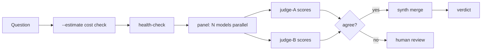

# muse-thinktank

> **One prompt, a council of models, zero hallucinations.**


[中文版](README_zh.md)

**Built for Muse users.** A multi-model deliberation orchestrator (multi-agent debate / LLM ensemble / AI council): one question goes to N models in parallel (panel), dual judges cross-validate, synth merges into a verdict. Pure Python standard library, zero dependencies.

**Model providers:** OpenRouter today; more carriers planned (see Roadmap).

## Who is this for?

- **Muse users** who want a second (third, fourth…) opinion before acting
- **Developers** who want multi-model code review on a PR before merging
- **Analysts** who need cross-validated answers with real-time data injected
- Anyone who's been burned by a single model's confident hallucination

```
Your question → [panel: N models in parallel] → [judge ×2 cross-validation] → [synth merge] → verdict
```

[](https://www.python.org/)
[]()
[](LICENSE)

> **New here?** Start with the [User Guide](docs/USER-GUIDE.md) — from zero to your first run in 15 minutes.
> （中文用户：先看[用户使用说明](docs/USER-GUIDE_zh.md)。)

## Quickstart

### Install via Muse chat

Copy-paste this into your Muse chat window:

```
Please help me install this open-source project: https://github.com/stoneskin/muse-thinktank
Follow the steps in AI_SETUP.md in the repo.
When you need an API key, stop and tell me to get one free at https://openrouter.ai/keys first.
```

### Install via terminal

```bash
export OPENROUTER_API_KEY=<redacted>   # get one free at https://openrouter.ai/keys
python3 thinktank.py ask \
  --models nvidia/nemotron-3-ultra-550b-a55b:free,nvidia/nemotron-3-super-120b-a12b:free \
  --judge-model nvidia/nemotron-3-ultra-550b-a55b:free \
  "Analyze Tesla's risks over the next 3 months"
```

The verdict goes to stdout; progress goes to stderr. Run `--estimate` first to see the cost:

```bash
python3 thinktank.py ask --estimate --models <...> "your question"
# prints: call count, token cap, cost cap, ETA
```

## Architecture



One entry point: `thinktank.py` + `tt/` package (stdlib only: `urllib` + `json` + `argparse`).

**AI assistants**: see [AI_SETUP.md](AI_SETUP.md) for machine-readable install & operate instructions.

## Key Features

| Feature | Pain point | Effect |
|---|---|---|
| **Dual-judge cross-validation** | A single judge hallucinating unnoticed | Disagreement auto-escalates to human |
| **Real-time data injection** (`--context-data`) | Stale training data (e.g. 2024 knowledge answering 2026 stock questions) | Orchestrator pre-searches live data; models analyze real numbers |
| **Dynamic member selection** | Free models flaky | Auto-filter by historical success rate × latency |
| **Fail-open / Fail-closed** | One dead model kills the round | Panel degrades gracefully; judges all-down → human |
| **Disagreement entropy** | No measure of panel divergence | Computed per round; scaffolds multi-round debate |

## Advanced

```bash
# Real-time data injection (must-have for time-sensitive questions)
python3 thinktank.py ask --context-data data.json \
  --models <...> "Analyze MSFT's current valuation"
# data.json: {"preamble": "...", "as_of": "...", "facts": {"price": "..."}}

# Dual judges (default: single)
python3 thinktank.py ask --judge-model <A> --judge-model2 <B> "..."

# Judge verdict only, skip synth (saves one call)
python3 thinktank.py ask --verdict "..."

# Show all answers side by side, human picks
python3 thinktank.py ask --show-all "..."

# Dynamic member selection (remembers model track record)
python3 thinktank.py ask --member-state ./members.json --capability-scores ./scores.json "..."

# Red-team mode (v0.5): critics attack the draft, adjudicator grades findings
python3 thinktank.py ask --red-team \
  --models <...> --judge-model <...> \
  --critic-models <...> \  # optional, defaults to panel models
  "Is this architecture sound?"
# Output: RED TEAM REPORT with verdict (revise/accept) and severity-graded
# findings (critical/major/minor; nitpicks filtered out)
```

See `examples/stock-analysis/` for the full "prepare-data-first" pattern.

## Examples

- **[Stock analysis](examples/stock-analysis/)** — inject real-time market data
  via `--context-data`; panel reasons over fresh numbers, not stale memory.
- **[Code review](examples/code-review/)** — point `--pr-diff` at a public
  GitHub PR; the diff is fetched automatically and a multi-model panel
  reviews the actual code. (This repo's own PR #1 was reviewed this way.)

## Philosophy

[The human–AI relationship](docs/human-ai-relationship.md) — why this tool
exists: AI amplifies human capability, but direction and taste are forever
human. ([中文版](docs/human-ai-relationship_zh.md))

## Contributing & Roadmap

- Issues / PRs welcome; look for the `good first issue` label
- PRs should include `--estimate` output (prove you didn't burn the budget)
- Roadmap: streaming output → Web UI → benchmark suite → multi-round debate convergence → **multi-carrier support** (beyond OpenRouter)

## Design Docs

[docs/design.md](docs/design.md) (work modes, judge powers, review framework) and
[docs/model-profiles.md](docs/model-profiles.md) (model capability profiles).

## Status

v0.5 (2026-10-12): red-team mode (`--red-team`) — critics attack the draft, adjudicator grades findings by severity.
v0.4 (2026-10-12): 4 code-review blockers fixed — prompt-injection hardening (`sanitize_context`), judge/panel global timeout, runtime budget circuit breaker, split into `tt/` package.

## License

Apache-2.0
