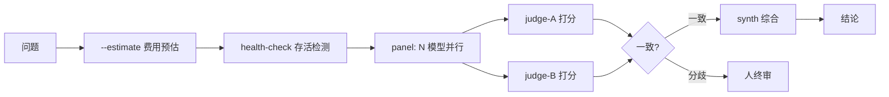

# muse-thinktank

> **One prompt, a council of models, zero hallucinations.**


[English](README.md)

**为 Muse 用户打造。**多模型智囊团编排器：一个问题并行发给 N 个模型（panel），双 judge 交叉验证，synth 综合出结论。纯 Python 标准库，零依赖。

**模型渠道：**目前仅支持 OpenRouter，未来会支持更多（见路线图）。

```
你的问题 → [panel: N 个模型并行] → [judge ×2 交叉验证] → [synth 综合] → 结论
```

[](https://www.python.org/)
[]()
[](LICENSE)

> **新手？**先看[用户使用说明](docs/USER-GUIDE_zh.md)——15 分钟跑起第一个智囊团。
> （New here? Start with the [User Guide](docs/USER-GUIDE.md).）

## 5 分钟快跑

```bash
export OPENROUTER_API_KEY=<redacted>   # https://openrouter.ai/keys 免费获取
python3 thinktank.py ask \
  --models nvidia/nemotron-3-ultra-550b-a55b:free,nvidia/nemotron-3-super-120b-a12b:free \
  --judge-model nvidia/nemotron-3-ultra-550b-a55b:free \
  "分析特斯拉未来3个月的风险"
```

终端直接出结论（stdout），每步进展走 stderr。先跑 `--estimate` 看费用预估：

```bash
python3 thinktank.py ask --estimate --models <...> "你的问题"
# 输出：调用次数、token 上限、费用上限、预计耗时
```

## 项目结构

- `thinktank.py` —— 主 CLI 入口。
- `tt/` —— Python 包（**tt = thinktank**，项目名缩写）。所有 harness 模块都在这里（`context.py`、`members.py`、`budget.py`……），外加用 `python3 -m tt.<name>` 运行的 CLI 工具（如 `tt.stock_context`）。
- `scripts/` —— 独立运维脚本（如 `tt-go.py`，estimate-first wrapper）。
- `docs/` —— 用户指南、设计文档、问题模板。


## 写给 AI agent

AI agent 不直接调用 `thinktank.py`——它们通过 **muse-thinktank skill**
（Agent Skills 兼容的 `SKILL.md`：安装 → 估算 → 运行 → 汇报）来调用。
skill 适用于任何能跑 shell 命令、读文件的 AI agent；repo 本身是纯 Python
零依赖，不调用任何专有 API。不过，这个项目优先为 Muse 用户打造：
针对 Muse 工作流优化，主要在 Muse 里测试。

## 架构



入口就一个：`thinktank.py` + `tt/` 包（纯标准库，`urllib` + `json` + `argparse`）。

**AI 助手**：看 [AI_SETUP.md](AI_SETUP.md) 获取机器可读的安装与操作指令。

## 核心特性

| 特性 | 解决什么痛点 | 效果 |
|---|---|---|
| **双 judge 交叉验证** | 单 judge 自己幻觉没人发现 | winner 不一致自动转人终审 |
| **实时数据注入** (`--context-data`) | 模型训练数据过时（如 2024 年知识答 2026 年股票） | 调度器先搜实时数据注入，模型用真数字分析 |
| **动态成员选择** | 免费模型时好时坏 | 按历史成功率 × 延迟自动过滤 |
| **Judge 黑名单**（v0.7） | 不靠谱的 judge 反复失败 | 连续 2 次失败进黑名单，24 小时冷却 |
| **防编造校验器**（v0.6） | 模型编造输出 | 校验"声称的运行"vs"实际运行"，抓编造 |
| **大 diff 切块评审**（v0.8/v0.9） | 大 diff 让 judge 崩溃（19k token 输入） | 四步流水线：骨架→切块→评审→一致性检查 |
| **Fail-open / Fail-closed** | 某模型挂了整轮报废 | panel 降级继续；judge 全挂转人工 |
| **分歧熵追踪** | 不知道模型们分歧有多大 | 每轮计算 entropy，为多轮辩论铺路 |

## 进阶用法

```bash
# 实时数据注入（时效性敏感问题必备）
python3 thinktank.py ask --context-data data.json \
  --models <...> "分析 MSFT 当前估值"
# data.json: {"preamble": "...", "as_of": "...", "facts": {"现价": "..."}}

# 双 judge（默认单 judge）
python3 thinktank.py ask --judge-model <A> --judge-model2 <B> "..."

# 只看 judge 结论，省一次 synth
python3 thinktank.py ask --verdict "..."

# 并列展示所有答案，人终审
python3 thinktank.py ask --show-all "..."

# 动态成员选择（跨轮次记住模型表现）
python3 thinktank.py ask --member-state ./members.json --capability-scores ./scores.json "..."

# 从人工维护的 model-profiles.md 生成 scores.json：
python3 -m tt.profiles_to_scores docs/model-profiles.md > scores.json
# 股票 40% + 代码 40% + 量化 20%，归一化到 0.0-1.0。
# 每次更新 profiles.md 后重新生成。

# 公开榜单先验（v0.5）：LMArena + OpenRouter 稳定性做基础分
python3 thinktank.py ask --priors --models <...> "..."
# 70% LMArena 能力分 + 30% 稳定性分（上线天数 × 限流宽松度）。
# 自己的 --capability-scores 优先覆盖。6 小时本地缓存，免 key。

# 备选模型（v0.5）：panel 掉人自动顶上
python3 thinktank.py ask --models <A>,<B> --backup-models <C>,<D> --min-panel 2 "..."
# panel 低于 --min-panel 时（health check 或中途掉线），备选按顺序顶上。
# 顶完还不够才 fail-closed。

# 红队模式（v0.5）：critics 攻击初稿，adjudicator 按严重性分级
python3 thinktank.py ask --red-team \
  --models <...> --judge-model <...> \
  --critic-models <...> \  # 可选，默认用 panel 同批模型
  "这个架构合理吗？"
# 输出：RED TEAM REPORT，含 verdict（revise/accept）与分级 findings
#（critical/major/minor；nitpick 已过滤）
```

看 `examples/stock-analysis/` 了解"先备数据再跑 panel"的完整模式。

# 切块 PR 评审（v0.9）：大 diff 四步流水线
python3 thinktank.py ask --pr-diff https://github.com/owner/repo/pull/123 \
  --chunk-tokens 3000 --models <...> "Review this PR"
# 1. 骨架提取（确定性，无模型调用）
# 2. 按文件切成 ~3k token 的块
# 3. 每块带着全局骨架独立评审
# 4. synth 检查跨文件一致性
# diff > 2× chunk-tokens 时自动触发。--chunk-tokens 0 可关闭。

## 示例

- **[股票分析](examples/stock-analysis/)**——用 `--context-data` 注入实时行情数据；panel 基于新鲜数字推理，而不是陈旧的训练记忆。
- **[代码评审](examples/code-review/)**——`--pr-diff` 指向公开 GitHub PR，自动拉 diff，多模型 panel 评审真实代码。（本仓库的 PR #1 就是这么评审的。）

## 理念

[人与 AI 的关系](docs/human-ai-relationship_zh.md)——为什么做这个工具：AI 放大人的能力，但方向和品味永远是人的。([English](docs/human-ai-relationship.md))

## 贡献 & 路线图

- 提 Issue / PR 欢迎，`good first issue` 标签见 Issues 页
- PR 请附 `--estimate` 输出（证明没烧掉预算）
- 路线图：流式输出 → Web UI → 基准测试套件 → 多轮辩论收敛 → **多渠道支持**（OpenRouter 之外）

## 设计文档

见 [docs/design.md](docs/design.md)（工作模式、Judge 三项权力、评审框架）与
[docs/model-profiles.md](docs/model-profiles.md)（模型能力档案）。

## 状态

v0.9（2026-10-13）：切块 PR 评审——四步流水线（骨架→切块→评审→一致性检查），"骨架常驻，细节按需加载"。
v0.8（2026-10-13）：map-reduce diff 切块（`--chunk-tokens`）。
v0.7（2026-10-13）：judge 黑名单——连续 2 次失败进黑名单，24 小时冷却。
v0.6（2026-10-13）：防编造校验器 + judge repair-retry（宽容 JSON 解析）。
v0.5（2026-10-12）：红队模式（`--red-team`）——critics 攻击初稿，adjudicator 按严重性分级；公开榜单先验（`--priors`）——LMArena + OpenRouter 稳定性做基础分。
v0.3b（2026-10-12）：双 judge、动态成员选择、实时数据注入（`--context-data`）、智囊团评审框架。

## License

Apache-2.0
